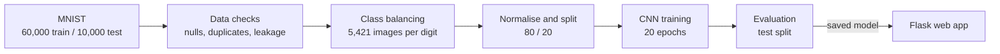
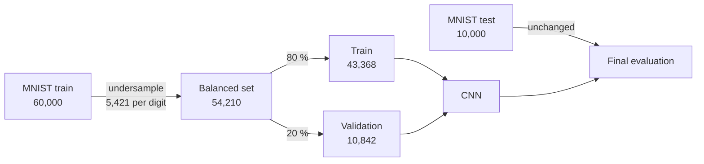
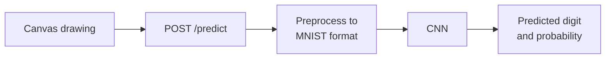

<div align="center">

# Handwritten Digit Recognition
**CNN-based digit classification on MNIST, with a draw-and-predict web app**

**CodeAlpha Machine Learning Internship, Task 3: Handwritten Character Recognition**

[](https://www.python.org/)
[](https://www.tensorflow.org/)
[](https://keras.io/)
[](https://flask.palletsprojects.com/)
[](LICENSE)

</div>

---

## Overview

Handwritten digit recognition is a standard test of whether a model can learn visual patterns from
raw pixels. This project trains a **Convolutional Neural Network (CNN)** on the
[MNISTDigit](https://data.mendeley.com/datasets/k864xjhrw6/1) dataset (the MNIST handwritten digits) to recognise the digits `0` to `9`, and serves the
trained model in a small **Flask web app** where a digit is drawn with the mouse and predicted in the
browser.

The work is split into three parts:

- **Data preparation.** The data is checked for null values, duplicates and train/test leakage,
  explored, and **balanced** by undersampling so that every digit appears equally often in training.
- **Model.** A compact CNN with two convolution blocks and dropout is trained and evaluated on the
  untouched MNIST test set, followed by a per-class and error analysis.
- **Web app.** The saved model is loaded by a Flask app that converts a canvas drawing into the MNIST
  format and returns the predicted digit with its probability.



### Key results

| Aspect | Result |
|---|---|
| Dataset | MNIST handwritten digits, 10 classes, 28 × 28 grayscale |
| Class balancing | Undersampled to 5,421 images per digit (54,210 in total) |
| Model | CNN with 2 convolution blocks and dropout, 225,034 parameters |
| Test accuracy | **99.36%** (macro F1 **0.9936**) |
| Training / validation accuracy | ≈ 99.9% / ≈ 99.2% |
| Misclassified test images | 64 out of 10,000 |
| Weakest / strongest digit (F1) | 5 (0.9905) / 0 and 4 (0.9969) |
| Web app | Draw a digit on a canvas and get the predicted digit with its probability |

---

## Table of contents

1. [Datasets](#1-datasets)
2. [Notebook and app](#2-notebook-and-app)
3. [Data preparation](#3-data-preparation)
4. [Model and training](#4-model-and-training)
5. [Results](#5-results)
6. [Error analysis](#6-error-analysis)
7. [Web app](#7-web-app)
8. [Reproducing the results](#8-reproducing-the-results)
9. [Limitations](#9-limitations)
10. [Repository structure](#10-repository-structure)
11. [License and references](#11-license-and-references)

---

## 1. Datasets

One public dataset was used. The balanced training set and the train/validation split are derived
from it inside the notebook.

| # | Dataset | Type | Built from | Used in | Link |
|---|---|---|---|---|---|
| 1 | MNISTDigit (MNIST) | Public, original | — | Source for dataset 2 and for testing | [Mendeley Data](https://data.mendeley.com/datasets/k864xjhrw6/1) |
| 2 | Balanced training set | Derived in the notebook | Training part of MNIST | Training and validation | `notebook/Handwritten_recognition.ipynb` |



### 1.1 MNISTDigit (original dataset)

| Property | Value |
|---|---|
| Source | [MNISTDigit, Mendeley Data](https://data.mendeley.com/datasets/k864xjhrw6/1) |
| Contributor | Arpit Rai (Mendeley Data, version 1, published 3 April 2023) |
| DOI | [10.17632/k864xjhrw6.1](https://doi.org/10.17632/k864xjhrw6.1) |
| Licence | CC BY 4.0 |
| Content | Grayscale images of handwritten English numerals 0-9, originating from NIST |
| Training images | 60,000 |
| Test images | 10,000 |
| Image size | 28 × 28 pixels, values 0-255 |
| Classes | 10 (digits 0-9) |
| File in this repository | `data/mnist.npz` (about 11.5 MB) |
| Main difficulty | A few digits have similar shapes (for example 5 and 3, 7 and 1) and some samples are ambiguous even for a person |

The training set is close to balanced but not equal: the smallest class is digit 5 with 5,421 images
and the largest is digit 1 with 6,742 images (about 1.24 times larger).

### 1.2 Balanced training set (derived dataset)

Created in the notebook from the MNIST training images. It is not published as a separate file.

| Property | Value |
|---|---|
| Method | Undersampling to the size of the smallest class |
| Images per digit | 5,421 (the first 5,421 images of each digit) |
| Total images | 54,210 (from 60,000, about 5,800 discarded) |
| Split | Stratified 80 / 20 into train and validation, seed 42 |
| Used for | Training and validation only |

**Design decisions**

- **Only real images are used.** Balancing removes surplus images instead of generating synthetic
  ones, so every training image is an original MNIST sample.
- **The test set is not balanced.** The original 10,000 test images are used exactly as released, so
  the final score reflects the real class mix.
- **Normalisation and the split come after balancing.** Neither the validation split nor any
  statistic is computed from the test images.

---

## 2. Notebook and app

| File | Description |
|---|---|
| `notebook/Handwritten_recognition.ipynb` | Full pipeline: data checks, EDA, class balancing, training, evaluation, error analysis, model saving |
| `app.py` | Flask app that loads the saved model and serves predictions |
| `templates/index.html` | Web page with the drawing canvas |
| `static/script.js`, `static/style.css` | Canvas drawing logic and page styling |
| `notebook/models/mnist_cnn.keras` | Trained CNN, written by the last notebook cell |

---

## 3. Data preparation

### 3.1 Data checks

| Check | Result |
|---|---|
| Null values in images and labels | 0 |
| Duplicate images in the training set | 0 |
| Test images that also appear in the training set (leakage) | 0 |

### 3.2 Class balancing

To make sure the model sees every digit equally often, the training data was undersampled to the size
of the smallest class (digit 5, 5,421 images). The first 5,421 images of every digit were kept, giving
**54,210 balanced images**.

### 3.3 Preprocessing and split

Pixel values were scaled to the range 0-1 and a channel dimension was added (`28 × 28 × 1`). The
balanced data was then split with a stratified 80 / 20 split (seed 42).

| Set | Images | Note |
|---|---:|---|
| Train | 43,368 | Balanced |
| Validation | 10,842 | Balanced |
| Test | 10,000 | Original MNIST test set, not balanced, not used in training |

---

## 4. Model and training

### 4.1 Architecture

| Layer | Details |
|---|---|
| Input | 28 × 28 × 1 |
| Conv2D + ReLU | 32 filters, 3 × 3 |
| MaxPooling2D | 2 × 2 |
| Conv2D + ReLU | 64 filters, 3 × 3 |
| MaxPooling2D | 2 × 2 |
| Flatten | 1,600 features |
| Dropout | 0.5 |
| Dense + ReLU | 128 units |
| Dense + Softmax | 10 classes |

Total parameters: 225,034.

### 4.2 Training protocol

| Setting | Value |
|---|---|
| Optimizer | Adam |
| Loss | Sparse categorical cross-entropy |
| Epochs | 20 |
| Batch size | 128 |
| Random seed | 42 |
| Hardware | CPU (Windows, TensorFlow 2.x) |

---

## 5. Results

### 5.1 Training progress

| Epoch | Train accuracy | Validation accuracy | Validation loss |
|---:|---:|---:|---:|
| 1 | 0.9047 | 0.9745 | 0.0904 |
| 5 | 0.9836 | 0.9894 | 0.0363 |
| 10 | 0.9897 | 0.9915 | 0.0319 |
| 16 | 0.9939 | 0.9927 | 0.0274 |
| 20 | 0.9952 | 0.9921 | 0.0314 |

Validation accuracy levels off at about 99.1-99.3% after roughly 10 epochs, while training accuracy
keeps rising slowly. The training accuracy printed during training is lower than the figure in the key
results (≈ 99.9%) because dropout is active while training; the 99.9% figure is measured with dropout
switched off.

### 5.2 Test set results

| Digit | Precision | Recall | F1-score | Images |
|:-:|---:|---:|---:|---:|
| 0 | 0.9959 | 0.9980 | 0.9969 | 980 |
| 1 | 0.9913 | 0.9982 | 0.9947 | 1135 |
| 2 | 0.9942 | 0.9942 | 0.9942 | 1032 |
| 3 | 0.9921 | 0.9931 | 0.9926 | 1010 |
| 4 | 0.9959 | 0.9980 | 0.9969 | 982 |
| 5 | 0.9899 | 0.9910 | 0.9905 | 892 |
| 6 | 0.9989 | 0.9864 | 0.9926 | 958 |
| 7 | 0.9922 | 0.9922 | 0.9922 | 1028 |
| 8 | 0.9888 | 0.9959 | 0.9923 | 974 |
| 9 | 0.9970 | 0.9881 | 0.9925 | 1009 |
| **Overall** | | | **0.9936** | **10,000** |

Accuracy and macro F1 are both 0.9936. The test set is nearly balanced and performance is even across
digits, so the two measures agree. Every digit has an F1-score above 0.99.

---

## 6. Error analysis

Only **64 of 10,000** test images were misclassified, spread over 33 different digit pairs. No single
mistake dominates.

**Most frequent mistakes (test split)**

| Rank | True digit | Predicted as | Times |
|---:|:-:|:-:|---:|
| 1 | 5 | 3 | 6 |
| 2 | 7 | 1 | 5 |
| 3 | 6 | 5 | 4 |
| 4 | 9 | 8 | 3 |
| 5 | 8 | 2 | 3 |
| 6 | 6 | 0 | 3 |
| 7 | 3 | 8 | 3 |
| 8 | 6 | 8 | 3 |
| 9 | 9 | 5 | 3 |
| 10 | 9 | 7 | 3 |

**Discussion**

- Recall is lowest for digit 6 (0.9864) and digit 9 (0.9881), the two digits most often mistaken for
  others.
- The most common confusions (5 and 3, 7 and 1, 6 and 5) involve digits with similar shapes.
- Many wrong predictions are hard to read even for a person, for example, a 7 with no crossbar, a 9 that
  is open at the top, or a scribbled 6. Part of the remaining error therefore comes from ambiguous
  handwriting rather than from the model.
- Some mistakes are made with high confidence, so the predicted probability should not be read as a
  guarantee of correctness.

---

## 7. Web app

A small **Flask** app lets a user draw a digit on a canvas and see the model's prediction.

### 7.1 Pipeline



| Setting | Value |
|---|---|
| Framework | Flask (development server) |
| Model file | `notebook/models/mnist_cnn.keras` |
| Canvas size | 320 × 320 pixels, black pen on white |
| Output | Predicted digit and its probability (%) |
| Empty canvas | The app asks for a digit instead of predicting |

### 7.2 Preprocessing

A drawing differs from an MNIST image in size, stroke thickness and position, so the app converts it
before prediction:

| Step | Purpose |
|---|---|
| Invert to white strokes on a black background | Match the MNIST colour convention |
| Crop to the drawn digit | Remove empty canvas |
| Scale to fit a 20 × 20 box, keeping the aspect ratio, and place in a 28 × 28 image | Match the MNIST size and margin |
| Thicken thin strokes, apply a slight blur, rescale intensity | Mouse strokes are thinner than pen-written MNIST digits |
| Centre by centre of mass | MNIST digits are centred this way |

### 7.3 Usage

```bash
python app.py
```

Open `http://127.0.0.1:5000`, draw a digit, click **Predict**, and use **Clear** to start again. Run
the command from the project root, because the app loads the model from
`notebook/models/mnist_cnn.keras`.

---

## 8. Reproducing the results

**1. Install**

```bash
git clone <your-repo-url>
cd CodeAlpha_Handwritten_Character_Recognition

python -m venv env
env\Scripts\activate          # Windows
# source env/bin/activate     # macOS / Linux

pip install -r requirements.txt
```

**2. Run the web app** (uses the already trained model)

```bash
python app.py
```

**3. Re-run the notebook** (optional, to retrain)

Open `notebook/Handwritten_recognition.ipynb` and select **Restart and Run All**. The notebook reads
the data from `../data/mnist.npz`, so it must be opened from inside the `notebook/` folder. The last
cell saves the model to `notebook/models/mnist_cnn.keras`.

Run order inside the notebook:

```text
Libraries → Data load → Checks (null, duplicate, leakage) → EDA
          → Class balancing → Normalise → Split → CNN training
          → Evaluation → Error analysis → Model save
```

Training 20 epochs took roughly 30 to 150 seconds per epoch on a CPU.

---

## 9. Limitations

- Only one architecture was trained, from one random seed, with no baseline such as a simple MLP.
  Retraining can change the accuracy by roughly 0.1-0.3%.
- Balancing was done by undersampling, which discards about 5,800 training images. The effect of
  balancing was not compared with training on the full, unbalanced data, so its benefit is not
  measured here.
- The reported 99.36% is measured on MNIST test images. Mouse drawings look different from
  pen-written MNIST digits, and the accuracy of the web app on real user drawings was not measured.
- No data augmentation (rotation, shifts, zoom) was used.
- The model recognises digits only, not letters or other characters.
- The Flask app runs on the built-in development server (`debug=True`) and is intended for local
  demonstration, not production.

---

## 10. Repository structure

```text
├── app.py                              Flask app (loads the model, serves predictions)
├── templates/
│   └── index.html                      Web page with the drawing canvas
├── static/
│   ├── script.js                       Canvas drawing and calls to /predict
│   └── style.css                       Page styling
├── notebook/
│   ├── Handwritten_recognition.ipynb   Data checks, EDA, training, evaluation
│   └── models/
│       └── mnist_cnn.keras             Trained CNN
├── data/
│   └── mnist.npz                       MNIST dataset
├── requirements.txt
├── LICENSE
└── README.md
```

---

## 11. License and references

The code in this repository is released under the [MIT License](LICENSE). Third-party components are
subject to their own licenses: TensorFlow and Keras, Flask, and the MNISTDigit dataset (CC BY 4.0, Mendeley Data).

**References**

1. A. Rai. *MNISTDigit.* Mendeley Data, Version 1, 2023. [doi:10.17632/k864xjhrw6.1](https://doi.org/10.17632/k864xjhrw6.1).
2. Y. LeCun, L. Bottou, Y. Bengio, P. Haffner. *Gradient-Based Learning Applied to Document
   Recognition.* Proceedings of the IEEE, 1998.
3. N. Srivastava, G. Hinton, A. Krizhevsky, I. Sutskever, R. Salakhutdinov. *Dropout: A Simple Way to
   Prevent Neural Networks from Overfitting.* JMLR, 2014.
4. D. P. Kingma, J. Ba. *Adam: A Method for Stochastic Optimization.* ICLR, 2015.
